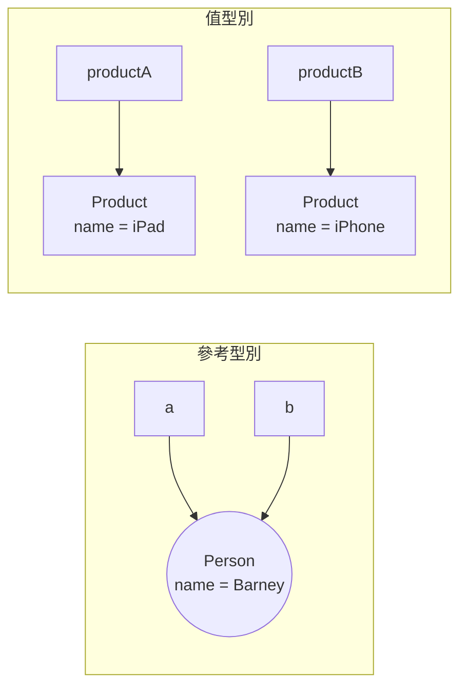
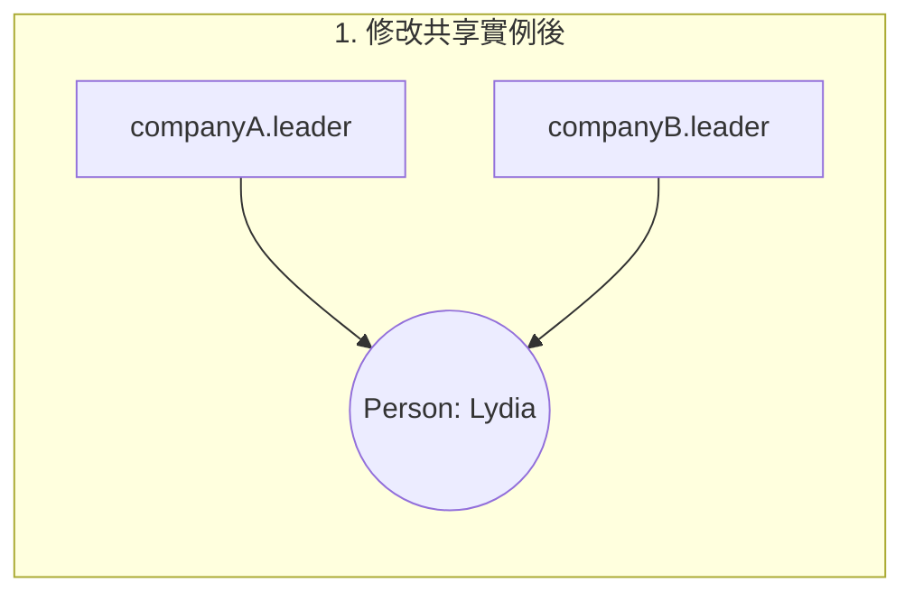
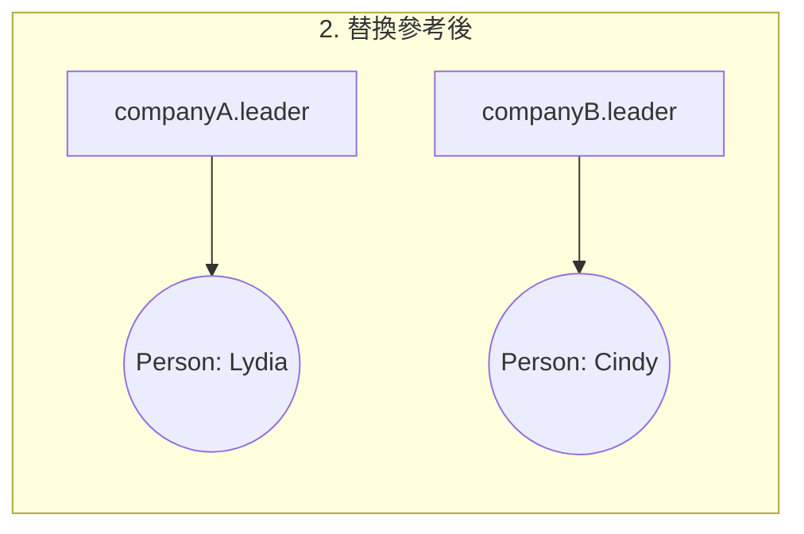

# 01 值與參考語意

> **TL;DR**
> - 複製 struct 會複製整個值；複製 class 只複製參考，兩個變數指向同一個實例。
> - struct 內含 class 時，複製 struct **不會**深層複製該 class，修改共享實例的狀態會互相影響，替換參考則不會。
> - `let` 鎖住的是「這個變數本身的值」：對 struct 是整個值，對 class 是參考，不是實例的內容。

日期：2026-10-14 ・ 環境：Xcode 26.0.1 / Swift 6.2 ・ 測試：[Tests/ValueAndReferenceTests.swift](Tests/ValueAndReferenceTests.swift)（執行 `swift test`）

## 想釐清的問題

1. 複製 struct 與 class，分別複製了什麼？
2. struct 內含 class，哪些修改會影響原本資料？
3. 修改共享物件與替換成新物件，有什麼差異？
4. 用 `let` 宣告的 struct 與 class，限制有何不同？

## 原本理解與預測

> 這一段是實驗前寫的，事後只修正錯字，保留原本的想法，方便對照「理解修正」。

### 1. 複製 struct 與 class，分別複製了什麼？

**Value Type**

- 指派值型別時，會複製其值。兩份值可以獨立修改；但若內含 class 屬性，複製的仍是該物件的參考，不會自動拷貝物件。
- 屬於該類型：`struct`、`enum`、`tuple`。標準函式庫的 `Int`、`String`、`Bool`、`Array`、`Dictionary` 也都是 struct。

**Reference Type**

- 指派 class 實例時，複製的是參考，沒有建立新的 class 實例。兩個變數指向同一物件，因此透過任一變數修改物件，另一個變數也能觀察到變化。
- 屬於該類型：`class`、`closure`、`actor`、`function`。



### 2. struct 內含 class，哪些修改會影響原本資料？

將包含 class 屬性的 struct 複製後，兩個 struct 具有獨立的值語意，但其 class 屬性仍參考同一個物件。因此，修改 struct 自身的值型別屬性不會影響另一份；修改共享 class 實例的內部狀態則會影響所有參考該實例的地方。

### 3. 修改共享物件與替換成新物件，有什麼差異？

在複製出來的 struct 裡修改 class 實例的屬性，會影響原本的 struct，因為兩者指向同一個實例。如果重新指派一個新的 class 實例，就不會再影響舊的實例。

### 4. let 對 struct 與 class 的限制有何不同？

- 用 `let` 宣告的 struct 無法修改自身的儲存屬性，但屬性所參考的 class 物件仍然可以修改。
- 用 `let` 宣告的 class，內部的 `var` 屬性可以修改。

## 實驗 A：純 struct

**預測**：修改其中一份，不會影響另一份。

```swift
var productA = Product(name: "iPhone", price: 30000)
let productB = productA

productA.name = "iPad"

#expect(productA.name == "iPad")
#expect(productB.name == "iPhone")
```

**結果**：符合預測。`productB` 在指派時取得的是 `productA` 當下值的複本，之後兩者沒有任何關聯。

## 實驗 B：class

**預測**：更改 `b` 的屬性時，`a` 的屬性也會變更。

```swift
let a = Person(name: "Cindy", age: 25)
let b = a

b.name = "Barney"

#expect(a === b)
#expect(a.name == "Barney")
```

**結果**：符合預測。`let b = a` 只複製了參考，`a === b` 證明兩者是同一個實例。

值得注意的是 `b` 用 `let` 宣告仍然能改 `name`：`let` 固定的是 `b` 這個**參考**，不是它指向的實例內容。

## 實驗 C：struct 內含 class

**預測**：複製 struct 後，內部的 class 仍會指向同一個實例，因此修改共享物件會影響兩個 struct；但重新指派 class 參考不會影響另一個 struct。

```swift
let companyA = Company(name: "Apple", leader: Person(name: "Barney", age: 26))
var companyB = companyA
#expect(companyA.leader === companyB.leader)

companyB.leader.name = "Lydia"                    // 1. 修改共享實例
#expect(companyA.leader.name == "Lydia")

companyB.leader = Person(name: "Cindy", age: 25)  // 2. 替換參考
#expect(companyA.leader !== companyB.leader)
#expect(companyA.leader.name == "Lydia")
```




**結果**：符合預測。複製 struct 不會自動深層複製內部的參考型別。1. 改的是「被共享的那個物件」；2. 改的是「companyB 自己的欄位」（欄位裡存的是參考），所以只影響 companyB。

## 實驗 D：`let` 的限制

```swift
let company = Company(name: "Apple", leader: Person(name: "Cindy", age: 25))

// company.name = "Google"
// cannot assign to property: 'company' is a 'let' constant
// company.leader = Person(name: "Bob", age: 30)
// cannot assign to property: 'company' is a 'let' constant
// company.rename(to: "Google")
// cannot use mutating member on immutable value: 'company' is a 'let' constant

company.leader.name = "Kon"  //  可以編譯

let a = Person(name: "BB", age: 37)
// a = Person(name: "Chine", age: 29)
//    cannot assign to value: 'a' is a 'let' constant
a.name = "Boat"              // 可以編譯
```

**結果**：符合預測，另外發現 `let` struct 也不能呼叫 `mutating` 方法。

`company.leader.name = "Kon"` 能編譯，是因為這行沒有改到 `company` 的值：`company.leader` 存的參考沒有變，變的是參考指向的物件。

## 實驗 E：讓「struct 內含 class」恢復值語意

實驗 C 揭露了一個設計問題：`Company` 看起來是值型別，實際上卻會和別人共享狀態。這種「假的值語意」是 bug 的常見來源。以下比較三種修法：

| 做法 | 實作 | 優點 | 代價 |
| --- | --- | --- | --- |
| E1 成員全為值型別 | `Person` 改成 struct | 最簡單，語意最清楚 | 不能保留 identity；大型資料每次複製可能有成本 |
| E2 不可變 class | `Person` 的屬性全改成 `let`，修改時建立新實例（`renamed(_:)`） | 共享也安全，保留 class 的能力 | 每次修改都要配置新物件，API 較囉唆 |
| E3 Copy-on-Write | struct 包一個私有 class 儲存體，寫入前用 `isKnownUniquelyReferenced` 檢查，被共享才複製 | 複製很便宜（只複製參考），對外仍是值語意；`Array`、`String` 就是這樣實作的 | 實作較複雜，每個 setter 都要記得呼叫 `makeUniqueIfNeeded()` |

完整實作見 [Tests/Models.swift](Tests/Models.swift)。E3 的關鍵行為由測試驗證：

- 複製後、寫入前：兩份值共用同一個儲存體（`storageIdentity` 相同）。
- 第一次寫入：偵測到共享 → 複製，兩份從此分開。
- 只有一個持有者時寫入：原地修改，不會多複製。

## 理解修正

| 原本以為 | 實際上 | 為什麼 |
| --- | --- | --- |
| struct 直接儲存值，因此 `let` 宣告後無法修改內部屬性 | `let` 是 Swift 的**可變性規則**，與記憶體配置無關 | 修改 struct 的儲存屬性等於修改整個值的一部分，所以 `let` 不允許；但若 struct 持有 class 參考，被參考的實例仍可修改 |
| 值型別存在 stack，參考型別存在 heap | **值語意 ≠ 存在 stack** | struct 被 escaping closure 捕獲、作為 class 的屬性、或放進 `any Protocol` 而且太大時，都可能配置在 heap。「值／參考」描述的是**複製時的行為**，不是存放位置 |
| `Int`、`String` 是另一類「基本型別」 | Swift 沒有基本型別這個分類 | `Int`、`String`、`Array` 都是標準函式庫裡定義的 struct |

## 實務取捨：什麼時候用 struct、什麼時候用 class

Apple 的建議是**預設使用 struct**，以下情況才選 class：

- 需要 **identity**：要判斷「是不是同一個」（`===`），例如代表同一個檔案控制代碼或連線的物件。
- 需要**共享的可變狀態**：多處要看到同一份更新（在並行環境下要考慮改用 `actor`）。
- 需要**繼承**，或要和 **Objective-C** 互通（`NSObject` 子類別）。

使用 class 的代價：引用計數（ARC）的開銷、可能出現循環參考，以及共享可變狀態帶來的推理成本。

比較運算子：

- `===`：比較兩個參考是否指向**同一個實例**，只能用在參考型別。
- `==`：比較**值是否相等**，型別必須遵循 `Equatable`。struct 只要所有成員都是 `Equatable` 就能自動合成，class 必須自己實作。

## 小結

> struct 是值型別，複製時會產生獨立的複本；class 是參考型別，複製的只是參考，多個變數會共享同一個實例。要注意的是 struct 裡如果包含 class，複製 struct 並不會深層複製那個物件，所以會出現看似是值、其實共享狀態的情況。解法可以讓成員都是值型別、讓 class 不可變，或像 Array 一樣實作 Copy-on-Write。我平常預設用 struct，需要 identity、共享狀態或繼承時才用 class

## 延伸問題

- [ ] `mutating` 方法與 `inout` 參數在底層是怎麼運作的？
- [ ] `Array` 的 Copy-on-Write 在什麼情況下會意外觸發複製？（例如在迴圈中修改、透過 closure 捕獲）
- [ ] 值型別與 `Sendable` 的關係：為什麼「struct 內含 class」在 Swift 6 並行檢查下會出問題？→ 銜接 Swift Concurrency 主題
- [ ] 用 Instruments 量測大型 struct 的複製成本

## 參考資料

- [The Swift Programming Language – Structures and Classes](https://docs.swift.org/swift-book/documentation/the-swift-programming-language/classesandstructures/)
- [Apple – Choosing Between Structures and Classes](https://developer.apple.com/documentation/swift/choosing-between-structures-and-classes)
- [WWDC15 – Building Better Apps with Value Types in Swift](https://developer.apple.com/videos/play/wwdc2015/414/)
- [WWDC16 – Understanding Swift Performance](https://developer.apple.com/videos/play/wwdc2016/416/)
- [AppCoda – Value Type 與 Reference Type](https://www.appcoda.com.tw/value-type-and-reference-type/)
