# 02. ARC 與實例生命週期

> **TL;DR**
> - ARC 是 Swift 自動管理記憶體的機制，依照強引用計數（strong reference count）決定實例的生命週期，計數歸零時釋放實例所佔的記憶體。
> - 必須注意強引用循環，善用 `weak`、`unowned`。

日期：2026-10-16

環境：Xcode 26.0.1 / Swift 6.2

測試：[Tests/](Tests/)（執行 `swift test`）

## 核心觀念

### ARC 機制

建立參考型別的實例時，ARC 會分配一塊記憶體來儲存該實例的資訊，並在適當的時機釋放該實例以節省記憶體的使用。

但 ARC 要怎麼判斷什麼是適當的時機，避免在還需使用這個實例時就將它清除呢？

當實例存在強引用時，ARC 會維持它的生命週期，避免在仍被使用時提前釋放。當實例不再有強引用時，ARC 就能銷毀該實例並回收相關記憶體。

強引用可能來自常數、變數、其他實例的儲存屬性，或 closure 的捕獲。

### Strong Reference Cycle（強引用循環）

必須特別注意的是，有時會發生兩個實例互相強引用，在前述的機制下因為雙方都還有強引用，ARC 就不會釋放任何一方，這稱為「強引用循環」，會造成記憶體洩漏。

強引用循環不一定只有兩個實例互相持有，也可能由多個實例或 closure 間接形成。

**階段一：外部變數各自強引用一個實例，兩個實例之間也互相強引用**

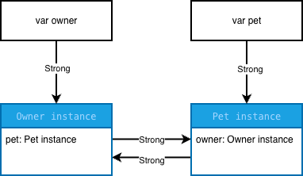

**階段二：外部變數都設為 nil 之後**

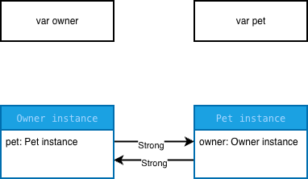

外部變數都清除後，已經沒有任何程式碼能存取這兩個實例，但它們仍互相強引用，強引用計數都不為 0，因此 ARC 不會釋放任何一方。

### Weak Reference 與 Unowned Reference

前面提到，當兩個實例互相強引用時，即使外部變數都已經清除，ARC 仍無法釋放這兩個實例，形成強引用循環。

為了解決這個問題，Swift 提供兩種不會增加強引用計數的引用方式：`weak`（弱引用）和 `unowned`（無主引用）。

兩者都不會延長被引用實例的生命週期，但對於**被引用的實例釋放後的處理方式**有重要差異。

#### Weak Reference（弱引用）

`weak` 不會對實例建立強引用，因此不會阻止 ARC 釋放該實例。

當被引用的實例釋放後，Swift 會自動將對應的 `weak` 屬性設為 `nil`，這個機制稱為 **Zeroing Weak Reference**。

因此，`weak` 適合用於「被引用的實例可能比持有引用的實例更早釋放」的情境。

**特性**：

- 不增加強引用計數。
- 不會延長被引用實例的生命週期。
- 被引用的實例釋放後，自動變成 `nil`。
- 必須使用 `var` 宣告，因為 ARC 需要在實例釋放時將其設為 `nil`。
- 在一般 class 引用情境下，必須宣告為 Optional。

例如：

```swift
final class Owner {
    var pet: Pet?
}

final class Pet {
    weak var owner: Owner?
}
```

引用關係：

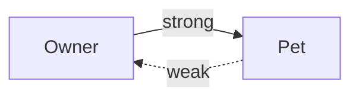

`Owner` 強引用 `Pet`，但 `Pet` 只弱引用 `Owner`，因此不會形成強引用循環。

當 `Owner` 被釋放後：

- `Pet.owner` 是 `weak`，不會阻止 `Owner` 釋放。
- 如果 `Pet` 仍然存在，`Pet.owner` 會自動變成 `nil`。
- 如果 `Pet` 沒有其他強引用，也會隨著 `Owner` 釋放而釋放。

#### Unowned Reference（無主引用）

`unowned` 與 `weak` 一樣，不會增加強引用計數，也不會阻止實例被釋放。

不同的是，一般的 `unowned` 引用**不會在被引用的實例釋放後自動變成 `nil`**。

因此，`unowned` 適合用於「能確保被引用的實例在每次存取時都仍然存在」的情境。

**特性**：

- 不增加強引用計數。
- 不會延長被引用實例的生命週期。
- 可以宣告為非 Optional，也可以宣告為 Optional。
- 一般的 `unowned` 引用不會自動歸零。
- 若存取已經釋放的實例，會觸發 runtime trap（執行期錯誤），程式直接結束。

例如：

```swift
final class Owner {
    var pet: Pet?
}

final class Pet {
    unowned let owner: Owner

    init(owner: Owner) {
        self.owner = owner
    }
}
```

引用關係：

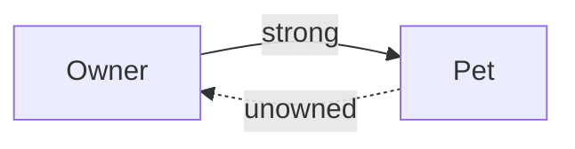

這段程式碼表達的是：`Pet` 不負責維持 `Owner` 的生命週期，但開發者必須確保每次存取 `Pet.owner` 時，`Owner` 都還存在。

需要特別注意：**使用 `unowned` 並不代表 ARC 會保證 `Owner` 比 `Pet` 活得久。** 這是開發者需要自行維持的生命週期契約。

#### `weak` 與 `unowned` 的差異

| 比較項目 | `weak` | `unowned`（一般形式） |
| --- | --- | --- |
| 增加強引用計數 | 否 | 否 |
| 延長實例生命週期 | 否 | 否 |
| 被引用的實例釋放後 | 自動變成 `nil` | 不會自動歸零 |
| Optional | 一般必須使用 | 可使用，也可不使用 |
| 宣告方式 | `weak var` | `unowned var` / `unowned let` |
| 存取已釋放的實例 | 得到 `nil` | runtime trap |
| 適用情境 | 被引用的實例可能先釋放 | 能保證存取時被引用的實例仍存在 |

**選擇原則**：

`weak` 和 `unowned` 都能用來避免強引用循環，但選擇哪一種方式，取決於實例之間的生命週期關係。

- **`weak`**：被引用的實例可能先釋放，因此允許引用變成 `nil`。
- **`unowned`**：預期被引用的實例在存取時一定存在；若無法保證，就不應使用一般的 `unowned`。

不能單純因為不想處理 Optional，就選擇 `unowned`。

## 實驗

### 觀察方式

所有實驗共用以下兩種觀察方式：

- **weak probe**：`weak var probe = owner`。`weak` 不增加強引用計數，實例釋放後自動變成 `nil`，因此 `probe != nil` 代表實例仍存在，`probe == nil` 代表已釋放。
- **EventRecorder**：在 `deinit` 中記錄事件，可以驗證「有沒有執行」與「執行順序」。不用 `print` 是因為它只能用眼睛看，而且 Swift Testing 預設平行執行，輸出會交錯。

### 實驗 A：Strong Reference 與實例生命週期

**實驗問題**：同一個實例被兩個變數持有時，清除其中一個會發生什麼？

**預測**：只清除一個不會釋放。只要強引用計數未歸零，就不會釋放。釋放前會先執行 `deinit`，可藉此觀察。

**實驗**：

```swift
var a: StrongReference.Pet? = StrongReference.Pet(recorder: recorder)
var b = a
weak var probe = a

a = nil
// probe != nil、recorder.events 為空

b = nil
// probe == nil、recorder.events == ["Pet deinit"]
```

**結果**：符合預測，直到實例不再被任何變數強引用才會釋放。

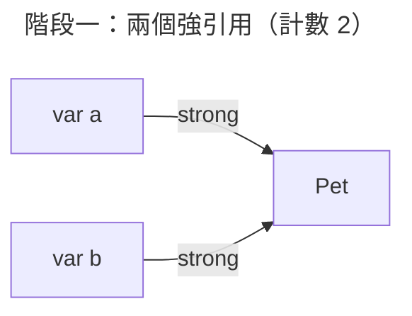

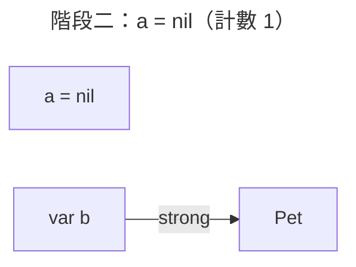

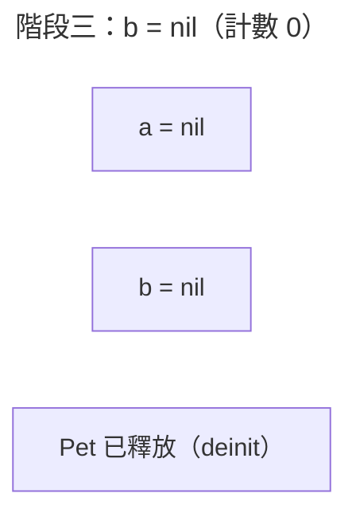

- `var b = a` 複製的是引用，`a` 和 `b` 指向同一個實例，強引用計數為 2。
- `a = nil` 只清除變數 `a` 的引用，計數 2 → 1，實例仍被 `b` 持有，`deinit` 沒有執行。
- `b = nil` 後計數歸零，執行 `deinit`，實例被釋放，`probe` 自動變成 `nil`。

### 實驗 B：Strong Reference Cycle

**實驗問題**：`Owner` 與 `Pet` 互相強引用時，兩個外部變數都設為 `nil`，會執行 `deinit` 嗎？

**預測**：只要一方強引用計數未歸零就不會被釋放，進而繼續持有另一方，造成強引用循環，兩者都不會被釋放。

**實驗**：

```swift
owner?.pet = pet
pet?.owner = owner

owner = nil
pet = nil
// ownerProbe != nil、petProbe != nil、recorder.events 為空

ownerProbe?.pet = nil
// 兩者都被釋放，recorder.events == ["Pet deinit", "Owner deinit"]
```

**結果**：符合預測。

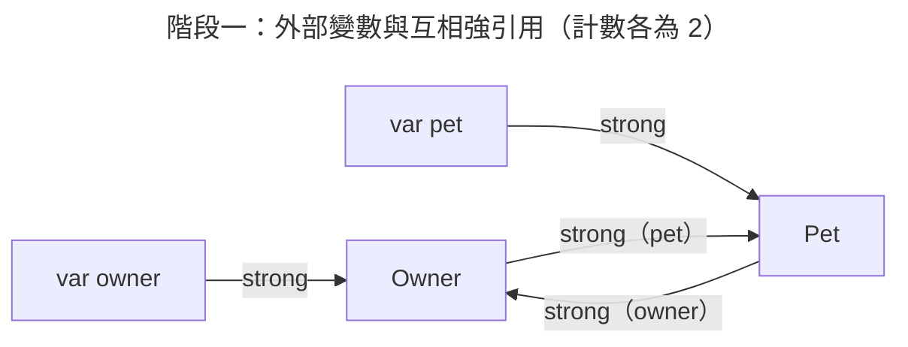

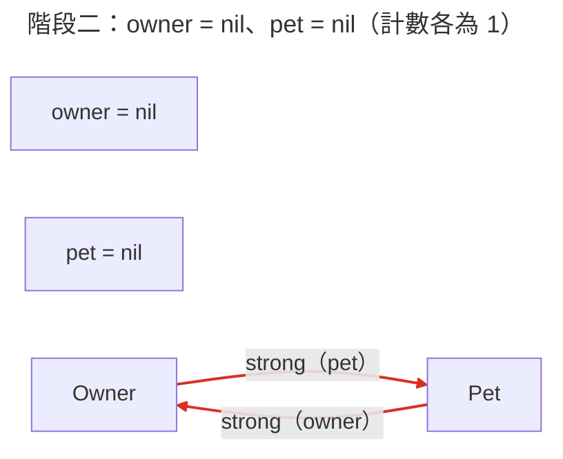

- 階段一：`Owner` 被 `var owner` 和 `pet.owner` 強引用，`Pet` 被 `var pet` 和 `owner.pet` 強引用，計數各為 2。
- 階段二：外部變數清除後，計數各剩 1，都不為 0，**兩個 `deinit` 都沒有執行**。
- 測試裡還能透過 `ownerProbe` 存取這兩個實例，但實際程式中通常沒有這種 `weak` 引用，這時已經沒有任何程式碼能存取它們，也就是記憶體洩漏。
- 手動執行 `ownerProbe?.pet = nil` 斷開循環：`Pet` 計數歸零先釋放 → 它的 `owner` 屬性被銷毀 → `Owner` 計數也歸零接著釋放，所以順序是 `Pet` 先、`Owner` 後（連帶釋放）。

手動斷開需要開發者記得在正確的時機執行，很容易遺漏，因此實務上會改用 `weak` 或 `unowned`。

### 實驗 C：Weak Reference 與自動歸零

**實驗問題**：將 `Pet.owner` 改成 `weak` 後，為什麼 `Owner` 可以被釋放？`Pet` 又會發生什麼事？

**預測**：當其中一方使用 `weak` 時，就會變成弱引用，強引用計數不會增加。

**實驗**：

```swift
enum WeakBackReference {
    final class Owner {
        var pet: Pet?
    }

    final class Pet {
        weak var owner: Owner?   // 與 StrongCycle 的差異
    }
}

owner = nil
// ownerProbe == nil：Owner 立即被釋放
// pet?.owner == nil：weak 被自動設為 nil
// petProbe != nil：Pet 仍被 var pet 持有
```

**結果**：符合預測，並驗證了 `weak` 會自動歸零。

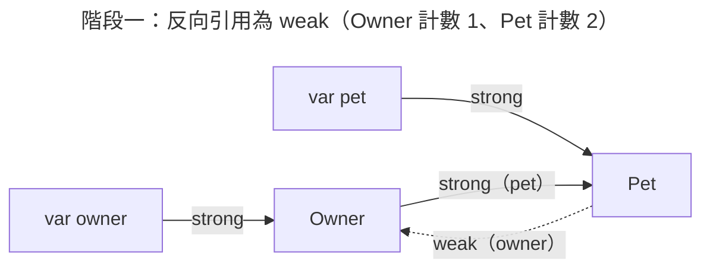

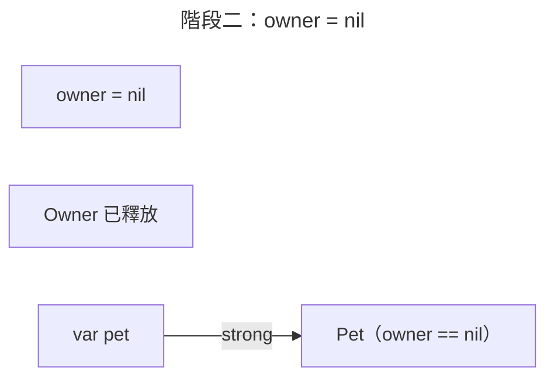

- `pet.owner` 是 `weak`，不計入強引用計數，所以 `Owner` 的強引用只有 `var owner` 一個，計數為 1。
- `owner = nil` → `Owner` 計數歸零，立即釋放。
- `Owner` 釋放時，它的 `pet` 屬性被銷毀，`Pet` 計數 2 → 1，因為 `var pet` 仍持有而繼續存在。
- `pet.owner` 被自動設為 `nil`（Zeroing Weak Reference），之後存取不會讀到已釋放的實例。

**與 B 對照**：兩者只差 `Pet.owner` 前面的 `weak`。B 的 `Owner` 計數是 2，C 只有 1，所以外部變數一清除就能釋放。

**`weak` 要加在哪一邊**：`Owner` 擁有 `Pet`，`Pet.owner` 是指回擁有者的反向引用，所以 `weak` 加在 `Pet.owner`。如果反過來把 `Owner.pet` 設成 `weak`，只要外部的 `var pet` 被清除，`Pet` 就會在 `Owner` 還存在時被釋放，不符合「`Owner` 擁有 `Pet`」的關係。

### 實驗 D：Unowned Reference 與生命週期契約

**實驗問題**：`Pet` 使用 `unowned` 指向 `Owner` 時，與 `weak` 有什麼差別？何時可以安全存取？

**預測**：

- 使用 `unowned` 時，被引用的實例不會增加強引用計數，當 `Owner` 被釋放後，`Pet` 也會連帶被釋放。
- `Owner` 的生命週期必定會比 `Pet` 長。
- 不管 `Owner` 有沒有被釋放，`pet.owner` 都不會變成 `nil`，可以不用處理解包的問題。

**實驗**：

```swift
enum UnownedBackReference {
    final class Pet {
        unowned let owner: Owner   // 非 Optional，建立時就必須給 Owner

        init(owner: Owner) {
            self.owner = owner
        }
    }
}

owner?.pet = UnownedBackReference.Pet(owner: owner!)
owner?.pet?.owner === owner   // Owner 存活時可直接存取，不需要解包

owner = nil
// ownerProbe == nil、petProbe == nil
// recorder.events == ["Owner deinit", "Pet deinit"]
```

**結果**：部分符合預測。`unowned` 不增加強引用計數、`Owner` 存活時不需要解包都符合；但「`Owner` 必定比 `Pet` 活得久」是這個模型刻意成立的生命週期契約，不是 ARC 的保證，`Owner` 釋放後再存取會觸發 runtime trap（見實驗 E）。

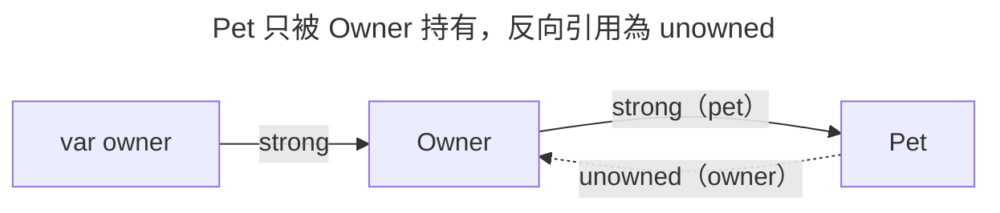

- `unowned` 和 `weak` 一樣不增加強引用計數，所以沒有循環：`owner = nil` 後 `Owner` 釋放，連帶釋放只被它持有的 `Pet`。
- 與 `weak` 的差別：`unowned let owner: Owner` 是非 Optional，使用時不需要解包，也可以宣告為 `let`；代價是 Swift 不會在 `Owner` 釋放後把它設成 `nil`。
- 何時可以安全存取：只要 `Owner` 還存在。這個模型中 `Pet` 只被 `Owner` 持有，`Pet` 不可能比 `Owner` 活得久，因此每次存取 `pet.owner` 時 `Owner` 一定存在。這就是使用 `unowned` 時要成立的生命週期契約。

### 實驗 E：生命週期不符合預期時的 Weak Reference 與 Unowned Reference

**實驗問題**：假設 `Pet` 比 `Owner` 活得久，使用 `weak` 與 `unowned` 分別會發生什麼？

**預測**：

- **`weak`**：若 `Pet` 活得比較久，`Owner` 被釋放後，`pet.owner` 會變成 `nil`。
- **`unowned`**：`pet.owner` 不會變成 `nil`，此時存取會導致錯誤並 crash。

**實驗**：

```swift
// E-1：weak
var owner: WeakBackReference.Owner? = WeakBackReference.Owner()
let pet = WeakBackReference.Pet()
pet.owner = owner
owner = nil
pet.owner == nil   // 安全，讀到 nil

// E-2：unowned，在子行程中執行
await #expect(processExitsWith: .failure) {
    var owner: UnownedBackReference.Owner? = UnownedBackReference.Owner()
    let pet = UnownedBackReference.Pet(owner: owner!)
    owner = nil
    _ = pet.owner   // Owner 已釋放 → runtime trap
}
```

**結果**：符合預測。

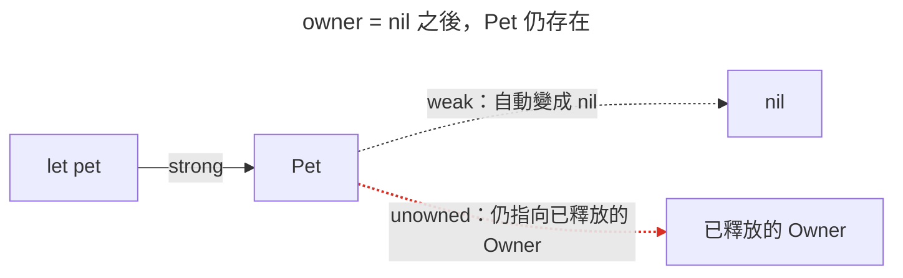

- **`weak`**：`Owner` 釋放後，`pet.owner` 自動變成 `nil`，程式可以用 `if let` / `guard let` 處理這個情況。
- **`unowned`**：`Owner` 釋放後，`pet.owner` 不會變成 `nil`，存取時觸發 runtime trap（`Attempted to read an unowned reference but object ... was already deallocated`），程式直接結束。
- 生命週期契約被打破時，`weak` 讓錯誤變成可處理的 `nil`，`unowned` 則讓錯誤立刻 crash。後者至少比讀到錯誤資料容易發現，但不能拿來處理「本來就可能發生」的情況。

**為什麼要隔離測試**：runtime trap 會讓整個行程結束。Swift 6.2 的 exit test（`#expect(processExitsWith:)`）會把 closure 放到子行程執行，只檢查子行程是否以失敗結束，不會影響其他測試。這個 closure 不能捕獲外部變數，所以 `Owner` 和 `Pet` 都要在 closure 內建立。

### 實驗 F：Closure 的 Strong Reference Cycle

**實驗問題**：實例持有 closure，closure 又捕獲 `self` 時，為什麼實例無法釋放？

**預測**：

- closure 也是參考型別，在互相持有的時候也會出現強引用循環。
- 使用 `weak` 不會增加實例的強引用計數，可以避免強引用循環。

**實驗**：

```swift
enum ClosureCycle {
    final class Owner {
        var feedCount = 0
        var onFeed: (() -> Void)?

        func setUpStrongCapture() {
            onFeed = {
                self.feedCount += 1     // 預設強捕獲 self
            }
        }

        func setUpWeakCapture() {
            onFeed = { [weak self] in
                self?.feedCount += 1
            }
        }
    }
}
```

**結果**：符合預測。

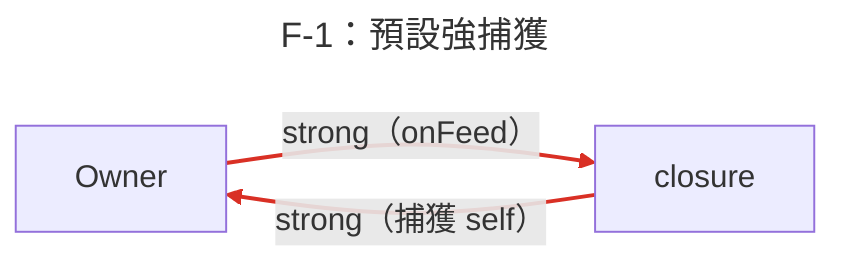

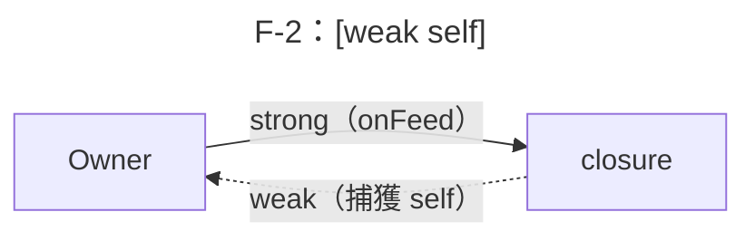

- closure 也是參考型別。`Owner` 用 `onFeed` 屬性強引用 closure，closure 預設又強捕獲 `self`，形成和實驗 B 一樣的循環，只是另一端換成 closure。
- F-1：`owner = nil` 後 `probe != nil`，`Owner` 沒有被釋放；手動執行 `probe?.onFeed = nil` 斷開後才釋放。
- F-2：改用 `[weak self]` 後，closure 不增加 `Owner` 的強引用計數，`owner = nil` 即釋放。存活期間呼叫 `onFeed` 仍正常運作（`feedCount == 1`）。

### 實驗 G：Closure Capture List 的選擇

**實驗問題**：`[weak self]` 一定是最好的選擇嗎？何時適合 `[unowned self]`？強捕獲何時合理？

**預測**：

如果 closure 是由實例本身持有，實例的生命週期必定比 closure 長，可以使用 `[unowned self]`，使用時可省去解包。

如果 closure 會被外部實例持有，就要考慮該 closure 是不是一定要完成。用強捕獲會延長 `Owner` 的生命週期，一定會等所有 closure 都執行完才釋放 `Owner`。如果用 `[weak self]`，`Owner` 在 closure 執行完前就被釋放，那 closure 也會跟著被釋放。

**實驗**：

| 測試 | 情境 | 捕獲方式 |
| --- | --- | --- |
| G-1 | 同步、non-escaping closure（`forEach`） | 強捕獲 |
| G-2 | closure 由 `self` 保存（`onFeed`） | `[unowned self]` |
| G-3 | closure 交給外部佇列，之後才執行 | 強捕獲 |
| G-4 | closure 交給外部佇列，之後才執行 | `[weak self]` |

**結果**：部分符合預測。`[unowned self]` 與強捕獲的判斷都符合；但 `[weak self]` 的情況中，closure 不會因為 `Owner` 釋放而跟著釋放，它仍由佇列持有並照常執行，只是 `self` 已是 `nil`，工作被略過。

| 測試 | 結果 |
| --- | --- |
| G-1 | closure 執行完就結束，不會被保存，不形成循環，`Owner` 正常釋放 |
| G-2 | closure 不可能比 `Owner` 活得久，存取安全，也不形成循環 |
| G-3 | `owner = nil` 後 `Owner` 仍存在，直到佇列執行完工作才釋放，事件順序為 `["saved", "Owner deinit"]` |
| G-4 | `owner = nil` 即釋放，佇列執行時 `self` 已是 `nil`，工作被略過，事件中沒有 `"saved"` |

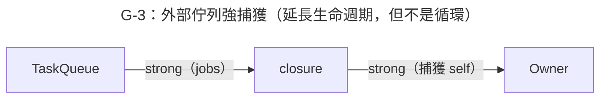

- **強捕獲不一定是錯的**。循環的條件是「`self` 直接或間接持有這個 closure」。G-1 的 closure 不會被保存，G-3 的 closure 由外部佇列持有，`Owner` 沒有持有它，所以都不是循環。
- **G-3 vs G-4 是行為上的選擇，不只是記憶體問題**：
  - 強捕獲：保證工作會完成，代價是 `Owner` 的生命週期被延長到工作結束。適合「一定要完成」的工作，例如儲存資料。
  - `[weak self]`：`Owner` 可以準時釋放，代價是工作可能被略過。適合「實例不在就不需要做」的工作，例如更新已經關閉的畫面。
- **`[unowned self]` 適合 closure 的生命週期被 `self` 包住的情況**（G-2）。好處是不需要處理 Optional；如果無法確定 closure 不會比 `self` 活得久，就應該用 `[weak self]`，否則會遇到實驗 E-2 的 runtime trap。

## 理解修正

| 原本以為 | 實際上 | 為什麼 |
| --- | --- | --- |
| 外部佇列的 closure 使用 `[weak self]`，`Owner` 先釋放時 closure 也會跟著釋放（實驗 G） | closure 仍由佇列持有並照常執行，只是 `self` 已是 `nil`，工作被略過 | closure 的生命週期由持有它的佇列決定，`[weak self]` 只影響 closure 對 `self` 的引用 |

## 實務取捨

| 情境 | 建議 | 代價 |
| --- | --- | --- |
| 反向引用：被持有的實例指回擁有者（例如 `Pet.owner`、delegate） | `weak` | 每次存取都要處理 Optional |
| 被引用實例的生命週期一定包住持有者（例如 closure 由 `self` 保存） | `unowned` / `[unowned self]` | 生命週期契約被打破時觸發 runtime trap |
| closure 交給外部，工作一定要完成（例如儲存資料） | 強捕獲 | 實例的生命週期被延長到工作結束 |
| closure 交給外部，實例不在就不需要做（例如更新已關閉的畫面） | `[weak self]` | 工作可能被略過 |
| 同步、non-escaping closure | 強捕獲 | 無，closure 不會被保存 |

## 小結

> ARC 用強引用計數管理參考型別實例的生命週期，計數歸零就釋放。要注意的是兩個實例、或實例和它保存的 closure 互相強引用時，會形成強引用循環，外部都不用了也釋放不掉。解法是把反向引用改成 `weak` 或 `unowned`：被引用的實例可能先釋放就用 `weak`，能保證存取時一定還在才用 `unowned`。closure 也不是一律加 `[weak self]`，要看 closure 由誰持有，以及工作是不是一定要完成。

## 延伸問題

- [ ] `weak` 引用在底層如何實作？（side table）
- [ ] `unowned(unsafe)` 與一般 `unowned` 有什麼差別？
- [ ] Swift Concurrency 的 `Task` 捕獲 `self` 時，會不會形成強引用循環？→  Swift Concurrency 
- [ ] 用 Xcode Memory Graph Debugger 與 Instruments（Leaks）找出強引用循環

## 參考資料

- [The Swift Programming Language – Automatic Reference Counting](https://docs.swift.org/swift-book/documentation/the-swift-programming-language/automaticreferencecounting/)
