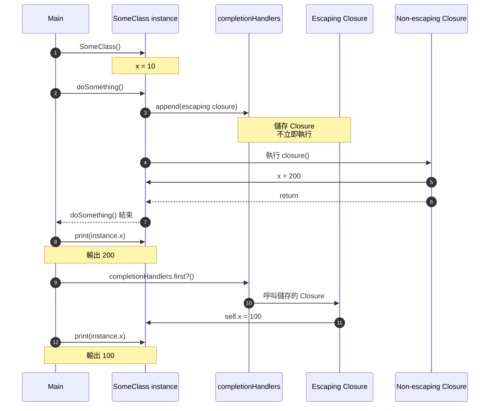

# 03. Closure 捕獲與循環引用

> **TL;DR**
> - 用 1–3 點寫結論，讓沒時間細看的人也能掌握重點。

日期：2026-11-04

環境：Xcode 26.0.1 / Swift 6.2

測試：[Tests/](Tests/)（執行 `swift test`）

## 核心觀念

### clouser 是什麼
clouser 跟 func 很像，是一個獨立的程式碼區塊，可以被儲存、傳遞、使用，但他必須指派給變數或常數或是作為 func 的參數。

直接看語法就很容易比較出兩者使用上的差異。

```swift
func name(parameters) -> ReturnType {
    // function body
}

var closure = { (parameters) -> ReturnType in
    // statements
}
```

clouser 有個特性是可以「捕獲」（Capture）程式碼中的常數或變數作為使用，如先前兩篇所描述 swift 會做記憶體的管理，但依然需要注意強引用循環的問題。


### Escaping Closures
當 closure 作為 func 的參數時，closure 一定會在 func 結束前執行完，並在 func return 生命週期結束時一起結束。

```swift
func function(printClouser: () -> Void) {
      print("a")
      printClouser()
      print("b")
}
someFunction { print("c") }

// a
// c
// b
```

`@escaping` 可以用來延續 clouser 的生命週期，在 func 生命週期結束後還存在，讓 clouser 可以在 func 外繼續被調用。


這是官方的範例
```swift
var completionHandlers: [() -> Void] = []
func someFunctionWithEscapingClosure(completionHandler: @escaping () -> Void) {
    completionHandlers.append(completionHandler)
}
func someFunctionWithNonescapingClosure(closure: () -> Void) {
    closure()
}


class SomeClass {
    var x = 10
    func doSomething() {
        someFunctionWithEscapingClosure { self.x = 100 }
        someFunctionWithNonescapingClosure { x = 200 }
    }
}


let instance = SomeClass()
instance.doSomething()
print(instance.x)
// Prints "200".


completionHandlers.first?()
print(instance.x)
// Prints "100".
```




怎麼用

何時用
## 想釐清的問題

1. 具體、可驗證的問題（避免「了解 XXX」這種無法驗證的題目）。實驗較多時可改用表格列出實驗、主題、實驗問題與對應測試。

## 原本理解與預測

> 實驗前寫，事後不修改。

## 實驗 A：標題

**實驗問題**：與「想釐清的問題」中的寫法逐字一致。

**預測**：……

**實驗**：

```swift
// 只放關鍵片段，完整程式碼以 Tests/ 為準
```
**結果**：符合預測 / 部分符合預測 / 與預測不同。說明原因。

## 理解修正

| 原本以為 | 實際上 | 為什麼 |
| --- | --- | --- |
|  |  |  |

## 實務取捨

什麼情況選哪個做法？代價是什麼？

## 小結

> 用口語寫一段能直接講出來的回答。

## 延伸問題

- [ ] 下一個實驗的題目

## 參考資料

[Closures](https://docs.swift.org/latest/documentation/the-swift-programming-language/closures/)