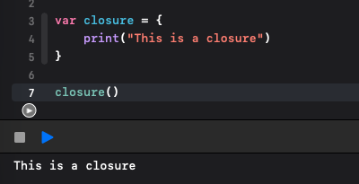
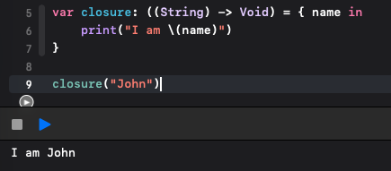
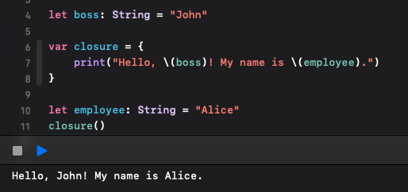

# 03. Closure 捕獲與循環引用

> **TL;DR**
>
> - Closure 可以作為值儲存與傳遞；trailing closure 只是呼叫語法的簡化。
> - Capture list 在建立 closure 時保存當下的值；若捕獲 class 實例，保存的是物件參考，而非物件副本。
> - `@escaping` 允許 closure 逃逸出接收它的 function；物件與 closure 互相強持有時，可能形成 strong reference cycle。

日期：2026-11-04

環境：Xcode 26.0.1 / Swift 6.2

測試：[Tests/](Tests/)（執行 `swift test`）

## 核心觀念

### Closure 是什麼

Closure 是可以被儲存與傳遞的程式碼區塊，常見用法包括指派給變數或常數，以及作為 function 的參數或回傳值。它也可以直接被呼叫。

比較 function 宣告與 closure expression 的語法，可以看到兩者都能定義參數、回傳型別與執行內容。以下是語法示意，其中的參數與型別需替換成實際定義。

```swift
// function
func name(parameters) -> ReturnType {
    // function body
}

// closure
{ (parameters) -> ReturnType in
    // statements
}
```

### Closure 的基本用法

最基本的用法是將 closure 指派給變數或常數。



Closure 也可以接收參數：



Closure 也可以作為 function 的參數，讓呼叫端決定要執行的動作。以下用 `cook` 模擬料理流程，透過 `onReady` 傳入餐點準備好後要執行的動作。

當最後一個參數是 closure 時，可以將 closure 寫在呼叫的括號外，這種寫法稱為 trailing closure（尾隨閉包）。也可以使用 `$0` 等簡寫參數名稱來簡化內容。

```swift
func cook(name: String, onReady: (String) -> Void) {
    // onReady 接收一個 String，且不回傳值（Void）
    print("開始料理 \(name)")
    // 呼叫傳入的 closure，將餐點名稱交給它
    onReady(name)
}

// 一般寫法：透過 onReady 參數傳入 closure
cook(name: "炒飯", onReady: { dish in
    // dish 是 closure 的參數名稱，收到的是 onReady(name) 傳入的「炒飯」
    // in 用來分隔 closure 的參數與執行內容
    print("\(dish) 好了，可以上桌！")
})

// trailing closure：將最後的 closure 移到括號外，並省略 onReady 標籤
cook(name: "炒飯") { dish in
    print("\(dish) 好了，可以上桌！")
}

// 簡寫參數名稱：$0 代表 closure 收到的第一個參數，這裡是「炒飯」
// 使用 $0 時，可以省略原本的 dish in
cook(name: "炒飯", onReady: { print("\($0) 好了，可以上桌！") })

// trailing closure 和 $0 也可以一起使用
cook(name: "炒飯") { print("\($0) 好了，可以上桌！") }
```

以上四種呼叫方式的行為相同，每次都會先輸出「開始料理 炒飯」，接著在 `onReady(name)` 呼叫 closure 時，輸出「炒飯 好了，可以上桌！」。將 closure 傳入 function 時，是把動作交給 function；執行到 `onReady(name)` 時，才會執行這個動作。

這個範例中的 closure 會在 `cook` 返回前同步執行。trailing closure 和 `$0` 只是語法上的簡化，不會改變執行順序，也不會讓動作自動變成非同步。

### Capture 與 Capture List

Closure 可以捕獲前後文中的常數或變數，並在執行時使用它們，這稱為 capture（捕獲）。



Capture list（捕獲列表）寫在 closure 開頭的方括號 `[]` 中，用來明確指定捕獲的項目與方式。列表中的運算式會在建立 closure 時求值，例如：

```swift
var name = "pizza"
let onReady = { [name] in
    print(name)
}
onReady() // pizza
```

如果捕獲的是 class 實例，保存的則是物件參考，不會複製整個物件；後面的實驗會對照 value type（值型別）與 reference type（參考型別）的捕獲行為。

### Escaping Closures

Function 的 closure 參數預設為 non-escaping，不能被保存供該 function return 後使用。Function 不一定要呼叫它；若有呼叫，必須在 return 前完成。

`@escaping` 允許 closure 在接收它的 function return 後仍被使用，例如將它存入外部陣列。它本身不會安排執行，也不代表非同步。

以下範例將 escaping closure 存入 `completionHandlers`，稍後才呼叫；non-escaping closure 則在接收它的 function 內立即執行。

以下沿用文末 Swift 官方文件的範例：

```swift
var completionHandlers: [() -> Void] = []
func someFunctionWithEscapingClosure(completionHandler: @escaping () -> Void) {
    completionHandlers.append(completionHandler)
}
func someFunctionWithNonescapingClosure(closure: () -> Void) {
    closure()
}

class SomeClass {
    var x = 10
    func doSomething() {
        someFunctionWithEscapingClosure { self.x = 100 }
        someFunctionWithNonescapingClosure { x = 200 }
    }
}

let instance = SomeClass()
instance.doSomething()
print(instance.x)
// Prints "200".

completionHandlers.first?()
print(instance.x)
// Prints "100".
```


### Strong Reference Cycle

Trailing closure 決定呼叫語法，capture list 決定捕獲項目與方式，`@escaping` 則允許 closure 逃逸出接收它的 function。三者處理不同問題。

當物件強持有 closure，而 closure 又強捕獲該物件時，可能形成 strong reference cycle（強引用循環）。例如：

```swift
final class Kitchen {
    let dish = "pizza"
    var onReady: (() -> Void)?

    func prepare() {
        onReady = {
            print("\(self.dish) 好了，可以上桌！")
        }
    }
}
```

呼叫 `prepare()` 後，持有關係是 `Kitchen instance → onReady closure → Kitchen instance`。若不清除 `onReady`，即使外部不再持有該 instance，這個循環仍會讓它無法釋放。

如果 closure 不需要維持物件存活，可以將指派改為使用 `[weak self]`：

```swift
onReady = { [weak self] in
    guard let self else { return }
    print("\(self.dish) 好了，可以上桌！")
}
```

這時 closure 不會強持有 `Kitchen` instance；若物件已釋放，closure 便直接返回。`[weak self]` 不是每個 closure 都必須加，應先檢查持有關係。更多 ARC 說明見 [02. ARC 與物件生命週期](../02-arc-and-object-lifetime/README.md)。

## 實驗 A：Capture List 與 Value Type、Reference Type

**實驗問題**：Closure 使用 capture list 與不使用時，捕獲行為有什麼差別？

**預測**（實驗前記錄，保留原本理解）：

有用 capture list 時會立刻捕獲當下的值，沒有用則是呼叫時才捕獲，與 value type 和 reference type 有關。

**實驗**：

以下片段需搭配 [Models.swift](Tests/Models.swift) 中的 `Closures.Dish` 定義使用。

```swift
// String 是 value type：capture list 保存建立 closure 當下的字串值。
var name = "pizza"
let capturedName = { [name] in name }
let sharedName = { name }
name = "pasta"

capturedName() // pizza
sharedName()   // pasta

// Dish 是 class：capture list 保存的是物件參考，不會複製整個物件。
var dish = Closures.Dish(name: "pizza")
let capturedDish = { [dish] in dish.name }
let sharedDish = { dish.name }
let capturedProperty = { [name = dish.name] in name }

dish.name = "pasta"
capturedDish()     // pasta：原物件的屬性已修改
capturedProperty() // pizza：保存的是修改前的 String 值

dish = Closures.Dish(name: "salad")
capturedDish() // pasta：仍指向原本的物件
sharedDish()   // salad：讀取外部變數重新指派後的物件
```

完整模型與六個對照測試見 [Models.swift](Tests/Models.swift) 與 [ClosuresTest.swift](Tests/ClosuresTest.swift)。

**結果**：部分符合預測。`[name]` 會在建立 closure 時保存當下的值；當捕獲的是 class 實例時，保存的是物件參考，因此仍可觀察到該物件的屬性變動。外部變數重新指派到另一個物件，則不會改變 capture list 已保存的參考。

未使用 capture list 的例子會捕獲可變區域變數，與外部程式碼共用儲存位置，所以執行時會讀到變數更新後的內容；不是等到呼叫時才開始捕獲。

| 情境 | 使用 capture list | 未使用 capture list |
| --- | --- | --- |
| `String` 變數從 pizza 改成 pasta | 保留 pizza | 讀到 pasta |
| 修改同一個 `Dish` 物件的 `name` | 讀到修改後的屬性 | 讀到修改後的屬性 |
| `Dish` 變數改指向另一個物件 | 仍指向原物件 | 讀到新物件 |

若要保存當下的名稱，可用 `[name = dish.name]` 直接捕獲 `String` 屬性。這裡的結論針對一般強參考捕獲；`weak`、`unowned` 另外影響物件的持有方式。

## 理解修正

| 原本以為 | 實際上 | 為什麼 |
| --- | --- | --- |
| 沒有 capture list，會在呼叫時才捕獲 | 這裡捕獲的是可變區域變數，執行時讀取其目前內容 | closure 與外部程式碼共用變數的儲存位置 |
| 使用 capture list 就能保留物件原本的屬性 | 捕獲 class 實例時保留的是參考，物件屬性仍可改變 | 捕獲參考不會複製物件；要保留名稱可捕獲 String 屬性 |

## 實務取捨

| 需求 | 做法與取捨 |
| --- | --- |
| 保存建立 closure 時的值 | 使用 `[name]`；之後不會跟著外部變數更新 |
| 讀取可變區域變數的後續更新 | 使用隱式捕獲；結果會受到變數更新影響 |
| 保存物件當下的名稱 | 使用 `[name = dish.name]`；只保存這個屬性值，不會複製物件 |
| 讓 closure 維持物件存活 | 強捕獲物件參考，並檢查是否形成 strong reference cycle |
| 物件釋放後就不再執行動作 | 使用 `[weak self]`，並處理 `self` 為 `nil` 的情況 |

## 小結

> Capture list 保存的是建立 closure 當下的值；對 class 而言，這個值是物件參考，所以屬性仍可能改變。沒有 capture list 的可變區域變數則由 closure 與外部程式碼共用，執行時讀取目前內容。
是否使用 `@escaping` 與是否形成 strong reference cycle，要另外看 closure 的使用方式與持有關係。


## 參考資料

[The Swift Programming Language — Closures](https://docs.swift.org/latest/documentation/the-swift-programming-language/closures/)
